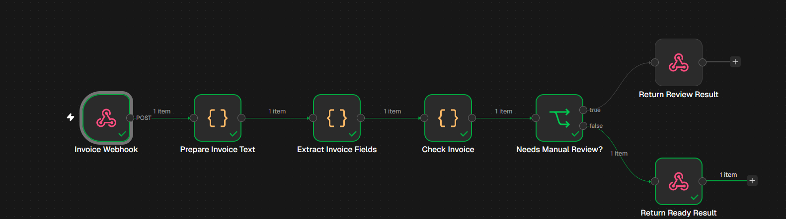
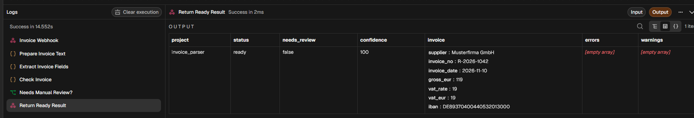

# n8n Invoice Parser — German Invoice Data Extraction

A lightweight, rule-based **n8n + JavaScript** automation that accepts invoice **text** via a webhook, extracts common fields from German invoices, validates the result, and returns a structured JSON response. The workflow routes invoices that require attention to a manual-review response.

> This project accepts text (such as text already extracted by OCR). It does **not** read PDF or image files directly, and it does not use an LLM.

## Workflow



**Pipeline:** `POST Webhook → Prepare Text → Extract Fields → Validate → Review Decision → JSON Response`

1. **Invoice Webhook:** Accepts a JSON `POST` request.
2. **Prepare Invoice Text:** Normalizes the supplied invoice text and checks minimum length.
3. **Extract Invoice Fields:** Uses JavaScript regular expressions to extract fields.
4. **Check Invoice:** Validates required fields and checks a German IBAN checksum.
5. **Needs Manual Review?:** Routes records with errors or invalid IBAN checksums to review.
6. **Return Ready/Review Result:** Returns the structured result to the caller.

## Extracted fields

| Field | Description |
| --- | --- |
| `supplier` | Supplier name |
| `invoice_no` | Invoice number |
| `invoice_date` | ISO date (`YYYY-MM-DD`) |
| `gross_eur` | Total amount in euros |
| `vat_rate`, `vat_eur` | VAT percentage and amount, when available |
| `iban` | German IBAN, normalized without spaces |
| `confidence` | Simple field-completeness score (not an accuracy guarantee) |
| `needs_review`, `status` | Review decision |
| `errors`, `warnings` | Validation details |

## Getting started

**Requirements:** A running n8n instance and PowerShell (for the example below).

1. Import [`workflow.json`](workflow.json) into n8n.
2. Open **Invoice Webhook** and click **Listen for test event**, or run **Execute workflow** so the test webhook is listening.
3. Open PowerShell and execute the following request **while the test webhook is listening**:

```powershell
$invoice = @'
Musterfirma GmbH
Rechnungsnummer: R-2026-1042
Rechnungsdatum: 10.11.2026
Gesamtbetrag: 119,00 EUR
MwSt 19%: 19,00 EUR
IBAN: DE89 3704 0044 0532 0130 00
'@

$body = @{ text = $invoice } | ConvertTo-Json

Invoke-RestMethod `
  -Uri "http://localhost:5678/webhook-test/invoice-parser" `
  -Method POST `
  -ContentType "application/json" `
  -Body ([System.Text.Encoding]::UTF8.GetBytes($body)) |
  ConvertTo-Json -Depth 10
```

The payload must include the `text` property (or alternatively `invoice_text`).

**Important:** In n8n test mode, the webhook usually accepts one request per listening session. Restart the listener before sending another test. For an active production deployment, use the production webhook URL and configure the workflow and access controls appropriately.

## Example response (successful test)

```json
{
  "project": "invoice_parser",
  "status": "ready",
  "needs_review": false,
  "confidence": 100,
  "invoice": {
    "supplier": "Musterfirma GmbH",
    "invoice_no": "R-2026-1042",
    "invoice_date": "2026-11-10",
    "gross_eur": 119,
    "vat_rate": 19,
    "vat_eur": 19,
    "iban": "DE89370400440532013000"
  },
  "errors": [],
  "warnings": []
}
```

### Test evidence

The sample invoice was sent to a local n8n test webhook on **November 10, 2026**. The ready branch executed successfully, returned the expected fields, and reported no warnings or errors.



**Testing scope:** The successful path shown here was tested manually. The manual-review branch is implemented but is not demonstrated by these screenshots.

## Validation behavior and limitations

- Missing supplier, invoice number, date, total amount, or insufficient input text triggers manual review.
- An invalid German IBAN checksum creates a warning **and** triggers manual review.
- A missing IBAN produces a warning but does not by itself trigger manual review.
- The parser is **rule-based**, tuned to common German invoice labels; layouts and field labels vary, so extraction is not universal.
- Input is truncated after 20,000 characters; the workflow reports a warning when that happens.
- `confidence` is a simple heuristic based on field presence and warnings, **not** a statistically calibrated confidence or accuracy measure.
- Always verify payment details against the original invoice before approving or initiating a payment.

## Repository files

- [`workflow.json`](workflow.json) — importable n8n workflow
- [`sample_invoice.txt`](sample_invoice.txt) — sample invoice text
- `workflow.png` — screenshot of the successful workflow
- `output.png` — screenshot of the structured result

## Tech stack

**n8n** · **JavaScript (Code nodes)** · **HTTP Webhooks** · **JSON** · **Regular Expressions**
